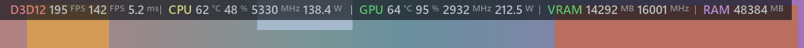
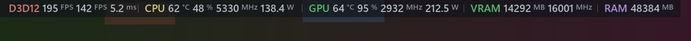

# SteamStyle-RTSS-OSD

A lightweight, native-rendered **Steam Performance Monitor** style skin and visual GUI tuner for **MSI Afterburner** + **RivaTuner Statistics Server (RTSS)** (`[OSDLayout1]`).




[English](#english) | [简体中文](#简体中文) | [繁體中文](#繁體中文)

> [!NOTE]
> **AI-Built Project Disclosure**: The repository owner barely participated in the development of this project (only providing in-game screenshots and visual preferences). Almost everything — from reverse-engineering `RTSSHooks64.dll` rendering quirks and Win32 GDI width math to the Python/Tkinter live tuner, automated tests, and documentation — was designed and completed end-to-end by **Antigravity** (Google DeepMind's agentic AI assistant). Shared as-is for anyone who wants the same clean overlay.
>
> **AI 独立完成声明**：仓库发布者本人几乎没有参与本项目的代码与技术制作（仅在游戏内看效果并提出视觉偏好），从反编译分析 `RTSSHooks64.dll` 渲染机制、Win32 GDI 字宽算法，到 Python/Tkinter 可视化调校器、自动化测试与说明文档，**全部由 Google DeepMind 旗下的 AI 助手 Antigravity 独立完成**。本项目按现状（AS-IS）开源分享，欢迎自由使用或配合 AI 二次修改。

---

<a id="english"></a>
## English

### Why Native `[OSDLayout1]` Instead of `OverlayEditor.dll`?
- **Zero OverlayEditor overhead**: Uses MSI Afterburner's native hypertext `[OSDLayout1]` engine (`PrologSeparator` / `GroupSeparator` / `FormatHeader`) paired with RTSS `[OSD]` & `[Font]`. No heavy `OverlayEditor.dll` background polling or sprite atlases needed.
- **Pixel-precise top-left docking**: Solves 4 undocumented RTSS hypertext rendering quirks discovered via binary inspection (`RTSSHooks64.dll`), achieving true `(0, 0)` screen-edge alignment, crisp scaled units, and solid translucent strips.
- **Live hot-reload**: Updates `Global` and all `EnableHooking=1` per-game `.cfg` files (while keeping `EnableHooking=0` exclusions and framerate `Limit=` untouched), triggers `RTSSHooks64.dll!UpdateProfiles()`, and reloads MSI Afterburner without restarting your running game.
- **Dynamic sensor & group layout**: Automatically parses active `ShowInOSD=1` sensors and custom `Group=` names (e.g. `VRAM`) from your `MSIAfterburner.cfg`, preserves any pre-existing left-to-right `GroupSeparator` group order, and measures exact Win32 GDI widths for your chosen font/size.
- **Customizable ordering & intra-group spacing**: Click group pills (`◀` / `▶` or quick presets) to reorder groups in the bar without modifying MSI Afterburner profiles, and tune `GroupNameSeparator` / `GroupDataSeparator` (`1–4` spaces) while per-group `<P=x,y>` anchors prevent proportional numbers from shifting adjacent groups.
- **1:1 RGBA visual preview + safe backups**: Preview bright, dark, and pure black scenes in real time before applying; automatically preserves a one-time `backups/initial/` snapshot before your first edit plus the last 10 rolling backups.

### Quick Start
1. **Requirements**: Windows 10 / 11, **MSI Afterburner**, **RivaTuner Statistics Server (RTSS)**, and **Python 3.10+** (with `tkinter`, included in standard python.org installers).
2. **Install & Launch**:
   ```bat
   pip install -r requirements.txt
   launch.bat
   ```
   *(Or double-click `launch.bat` — it automatically installs missing Pillow dependencies and launches via `pythonw.exe` without leaving a console window.)*
3. **Click `Apply Live`** (Administrator privileges are requested only when launching the GUI so RTSS / Afterburner directories under protected folders can be updated cleanly).

### Recommended MSI Afterburner Sensor Setup
In MSI Afterburner **Settings → Monitoring → Active hardware monitoring graphs**:
- Enable **Show in On-Screen Display** for the metrics you want (`Framerate`, `Framerate 1% Low`, `Frametime`, `CPU temperature/usage/clock/power`, `GPU temperature/usage/core clock/power`, `Memory usage`, `Memory clock`, `RAM usage`).
- **Intra-group metric order**: Drag items up or down inside the MSI Afterburner Monitoring list (`Sources=`) to control the metric sequence inside each group (for example `FPS → 1% Low → ms` vs `FPS → ms → 1% Low`). Inter-group pill order (`CPU` / `GPU` / `VRAM` / `RAM`) can then be arranged directly inside the tuner GUI.
- **VRAM vs MEM group name**: By default, `Memory usage` and `Memory clock` map to the `MEM` group; set **Override group name** = `VRAM` on both sensors if you prefer the classic `D3D12 | CPU | GPU | VRAM | RAM` header layout.
- **Leave `MSIAfterburner` OSD Layout set to `Modern`** (`OSDLayout=1` — the tuner automatically enforces this when applying).

### Technical Quirks Solved (RTSS Engine Notes)
1. **Position `(0, 0)` Centering Trap**: In `RTSSHooks64.dll`, `PositionX=0` or `PositionY=0` triggers `GetAnchorMode` center-screen pinning instead of origin `0`. Meanwhile, negative `<P=x,y>` coordinates are treated as `abs(x)` character cells. **Solution**: Set `PositionX=1, PositionY=1` and apply `<M=-1,-1>` immediately before the background rectangle so it renders flush from screen pixel `(0, 0)`.
2. **Rounded `<B=0,0,R8>` Missing Borders**: Two-zero rounded box syntax (`dwType=4`) drops the outer `R` px edge ring when `OverlayEditor.dll`'s dynamic circle sprite atlas is absent. **Solution**: Use explicit solid two-parameter `<B=W,H>` (`dwType=2`) with `<L0>...<L1>` line isolation.
3. **Blurry Scaled Units (`<S1>`)**: Without `CharsetSize1` matching `<S1=...>`, RTSS downscales the `100%` glyph texture bilinearly. **Solution**: Always synchronize RTSS `[Font] CharsetSize1` with `[OSDLayout1] <S1=...>`.
4. **Crisp Modern Typography + Fixed Anchors**: Sets `OutlinePassCount=0` / `OutlineFactor=0` with `Segoe UI Variable Text Semibold` (Win 11, auto-falling back to `Segoe UI Semibold` on Win 10) while keeping RTSS `Face` strictly `<= 31` ASCII bytes (`LOGFONTA.lfFaceName[32]`), and pairs compact `<A>` formatting with per-group `<P=x,y>` anchors so proportional digits never jostle neighbor groups.

### Running Tests
```bat
set PYTHONDONTWRITEBYTECODE=1
python -B -m unittest discover -s tests -v
```

---

<a id="简体中文"></a>
## 简体中文

### 为什么用原生 `[OSDLayout1]` 而不用 `OverlayEditor.dll`？
- **零 `OverlayEditor.dll` 插件开销**：直接利用微星小飞机（MSI Afterburner）内置的超文本排版引擎 `[OSDLayout1]` 与 RTSS `[OSD]`／`[Font]` 实现 Steam 2025 性能监控胶囊样式，无需开启重型 `OverlayEditor.dll` 后台轮询或加载额外精灵图集。
- **真正贴齐屏幕左上角 `(0, 0)`**：彻底解决了通过二进制分析 `RTSSHooks64.dll` 确认的 4 项底层渲染陷阱——贴边不悬空、实心矩形无圆角缺边、单位缩放字体清晰不糊。
- **免重启游戏实时热生效**：自动更新 `Global` 及所有启用监控（`EnableHooking=1`）的单游戏 `.cfg`（完整保留 `EnableHooking=0` 排除列表与既有 `Limit=` 锁帧上限），调用 `RTSSHooks64.dll!UpdateProfiles()` 并安全重载小飞机，游戏内即刻生效。
- **动态传感器识别与自定义排序／间距**：自动扫描 `MSIAfterburner.cfg` 中勾选 `ShowInOSD=1` 的传感器、华氏/摄氏单位与自定义 `Group=` 分组名（显存默认显示 `MEM`，设置 `Group=VRAM` 则显示 `VRAM`），并自动保留原有 `GroupSeparator` 从左到右的分组顺序。
- **可视化顺序切换、组内空白与固定锚点**：在界面点击分组胶囊按钮配合 `◀`／`▶`（或一键预设）即可调整横排前后顺序，还可微调组名后／数值间空白格数（`GroupNameSeparator`／`GroupDataSeparator`，`1–4` 格）；各分组与竖直分隔线均采用独立 `<P=x,y>` 绝对坐标锁定，比例字体数字跳动不会挤偏相邻分组。
- **1:1 实时预览与双重自动备份**：支持亮色／暗色／纯黑背景对比预览；首次应用前自动在 `backups/initial/` 保存完整初始备份（支持一键还原），并保留最近 10 次滚动备份。

### 快速开始
1. **环境要求**：Windows 10 / 11、**MSI Afterburner（微星小飞机）**、**RivaTuner Statistics Server (RTSS)**、**Python 3.10+**（请使用包含默认 `tkinter` 的官方安装包）。
2. **启动方式**：直接双击 [`launch.bat`](launch.bat)（缺少 `Pillow` 时会自动运行 `pip install -r requirements.txt` 并以无控制台窗口模式启动），或在终端运行：
   ```bat
   pip install -r requirements.txt
   launch.bat
   ```
3. 调好透明度、底色、是否贴边、字体大小与配色后，点击 **「Apply Live（立即套用）」** 即可在游戏左上角实时生效（仅交互启动 GUI 时会请求管理员权限，以便安全写入受保护目录与重载小飞机）。

### 微星小飞机监控项推荐设置
在 MSI Afterburner **设置 → 监控 → 激活的硬件监控图表** 中：
- 为需要显示的指标勾选 **在 OSD 上显示（Show in On-Screen Display）**（如 `Framerate`、`Framerate 1% Low`、`Frametime`、CPU 温度/占用/频率/功耗、GPU 温度/占用/核心频率/功耗、`Memory usage`、`Memory clock`、`RAM usage`）。
- **组内指标先后顺序**：直接读取小飞机监控列表（`Sources=`）的上下顺序（例如想将 `1% Low` 放到 `ms` 前面或后面，直接在小飞机监控列表上下拖拽即可）；不同分组之间（`CPU` / `GPU` / `VRAM` / `RAM`）的前后顺序可直接在本调校器界面一键调整。
- **`VRAM` 与 `MEM` 组名**：默认情况下 `Memory usage` 和 `Memory clock` 会归入 `MEM` 组；若希望像预览图那样显示 `D3D12 | CPU | GPU | VRAM | RAM`，请在这两项中勾选并填写 **替代组名（Override group name）** = `VRAM`。
- **请保持小飞机 OSD 布局为 `Modern`（现代样式）**：对应 `OSDLayout=1`，工具在应用时也会自动确保该设置正确。

### 已解决的 RTSS 底层渲染特性（技术说明）
1. **`Position (0, 0)` 居中陷阱**：在 `RTSSHooks64.dll` 中，`PositionX=0` 或 `PositionY=0` 会触发 `GetAnchorMode` 屏幕居中锚定，而负坐标 `<P=x,y>` 会被按字符格处理。**方案**：设为 `PositionX=1, PositionY=1`，并在背景矩形前紧跟 `<M=-1,-1>`，使底条精准从屏幕像素 `(0, 0)` 贴边绘制。
2. **圆角 `<B=0,0,R8>` 缺边问题**：在未加载 `OverlayEditor.dll` 动态圆形精灵图集时，双零圆角矩形语法（`dwType=4`）外圈 `R` px 边框会丢失。**方案**：改用显式宽高 `<B=W,H>` 实心矩形（`dwType=2`）配合 `<L0>...<L1>` 行隔离。
3. **单位缩放（`<S1>`）发虚模糊**：当 `[Font] CharsetSize1` 与 `[OSDLayout1]` 的 `<S1=...>` 不一致时，RTSS 会对 100% 字形纹理进行双线性缩水，导致单位发糊。**方案**：应用时同步写入 RTSS `[Font] CharsetSize1`。
4. **现代无衬线字体与固定锚点排版**：同步设置 `OutlinePassCount=0` / `OutlineFactor=0` 并选用 `Segoe UI Variable Text Semibold`（Win 11，Win 10 自动回退至 `Segoe UI Semibold`，字体名严格限制 `<= 31` ASCII 字节），并以紧凑 `<A>` 配合逐组 `<P=x,y>` 固定坐标彻底消除串位。

### 运行测试
```bat
set PYTHONDONTWRITEBYTECODE=1
python -B -m unittest discover -s tests -v
python -B steam_osd_tuner.pyw --self-test
```

---

<a id="繁體中文"></a>
## 繁體中文

### 為什麼用原生 `[OSDLayout1]` 而不用 `OverlayEditor.dll`？
- **零外掛負擔**：直接運用 MSI Afterburner 內建的超文字排版 `[OSDLayout1]` 與 RTSS `[OSD]`／`[Font]` 引擎，不必開啟額外後台或高負載 `OverlayEditor.dll` 外掛即可呈現 Steam 2025 效能監控膠囊外觀。
- **真正貼齊螢幕左上 `(0, 0)`**：徹底解決反組譯 `RTSSHooks64.dll` 確認的 4 項底層渲染陷阱，不會懸空偏移、不會因為圓角精靈圖缺失而缺邊、單位縮放銳利不模糊。
- **免重開遊戲即時熱套用**：自動更新 `Global` 與所有啟用中（`EnableHooking=1`）的遊戲個別 `.cfg`（完整保留 `EnableHooking=0` 排除名單與既有 `Limit=` 鎖幀設定），透過 `RTSSHooks64.dll!UpdateProfiles()` 並自動偵測／安全重啟 MSI Afterburner 即時生效。
- **動態感測群組與 GDI 實測字寬**：自動掃描你 `MSIAfterburner.cfg` 內勾選 `ShowInOSD=1` 的感測器、華氏/攝氏與自訂 `Group=` 群組名稱（未改時顯存預設為 `MEM`，若設為 `VRAM` 則顯示 `VRAM`），並自動沿用你原本 `GroupSeparator` 的群組左右順序，以 Win32 GDI 精確計算字體與分隔線座標。
- **自訂群組順序、組內間距與固定錨點**：可在介面直接點擊群組藥丸用 `◀`／`▶` 左右調換群組順序（或一鍵切換 `Steam 預設`／`依小飛機順序`），並調整組內標籤後／數值間空白格數（`GroupNameSeparator`／`GroupDataSeparator`，`1–4` 格）；各群組與分隔線各自鎖定 `<P=x,y>` 固定座標，比例字體數值跳動也不會推擠鄰組。
- **組內項目順序說明**：同一個群組內部的指標排列順序（例如 `FPS → 1% Low → ms` 或 `FPS → ms → 1% Low`）直接讀取 MSI Afterburner 監控列表（`Sources=`）的上下順序；想調整組內指標先後，直接於小飛機 **設定 → 監控** 拖曳排序即可。
- **1:1 預覽與安全雙重備份**：支援亮景／暗景／純黑對照即時預覽；第一次按套用前會自動於 `backups/initial/` 保存完整初始原版備份（支援一鍵還原），並保留最近 10 次滾動備份。

### 快速開始
1. **環境需求**：Windows 10 / 11、**MSI Afterburner**、**RivaTuner Statistics Server (RTSS)**、**Python 3.10+**（請保留官方安裝包預設的 `tkinter`）。
2. **啟動方式**：直接雙擊 [`launch.bat`](launch.bat)（若缺少 `Pillow` 會自動執行 `pip install -r requirements.txt` 並以無主控台視窗方式啟動），或於終端機執行：
   ```bat
   pip install -r requirements.txt
   launch.bat
   ```
3. 調完透明度、底色、是否貼邊、字體或配色後，按 **「立即套用（免重開遊戲）」** 即可於遊戲畫面左上角即時生效（程式僅於互動啟動 GUI 時請求系統管理員權限，以確保能寫入受保護目錄與重載 Afterburner）。

### 測試與自我驗證
```bat
set PYTHONDONTWRITEBYTECODE=1
python -B -m unittest discover -s tests -v
python -B steam_osd_tuner.pyw --self-test
```

---

## Credits / 致谢与声明
- **AI-Built Project**: This project was designed, coded, tested, and documented end-to-end by **Antigravity** (Google DeepMind's agentic AI assistant). The repository owner barely participated in the implementation, contributing only in-game screenshots, visual feedback, and real-world testing preferences. Shared freely as-is for the community.
- **关于制作者声明**：本项目从底层问题排查、算法实现、界面编写到文档与测试均由 **Antigravity**（Google DeepMind AI 助手）独立完成，发布者本人几乎未参与具体制作过程，仅负责在游戏内看效果并提出需求方向。欢迎自取使用。

---

## License
[MIT License](LICENSE)
